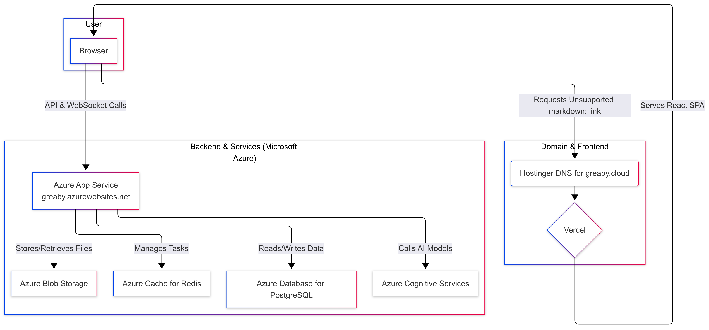

# Greaby.cloud AI Content Suite


A full-stack, AI-powered content creation and translation platform. This repository contains the complete source code for both the Django backend and the React frontend.

## Table of Contents

- [Project Overview](#project-overview)
- [Core Features](#core-features)
- [Deployment & Hosting Architecture](#deployment--hosting-architecture)
  - [High-Level Diagram](#high-level-diagram)
- [Technology Stack](#technology-stack)
  - [Backend](#backend)
  - [Frontend](#frontend)
  - [Infrastructure & Services](#infrastructure--services)
- [Getting Started: Local Setup](#getting-started-local-setup)
  - [Prerequisites](#prerequisites)
  - [Backend Setup](#backend-setup)
  - [Frontend Setup](#frontend-setup)
  - [Running the Application](#running-the-application)
  - [Production Configuration Notes](#production-configuration-notes)
- [Codebase Structure](#codebase-structure)
- [API Endpoints Overview](#api-endpoints-overview)
- [Future Improvements & Roadmap](#future-improvements--roadmap)

## Project Overview

Greaby.cloud is a multi-tenant, pay-as-you-go platform that offers a suite of AI-driven tools. It's designed to be a one-stop solution for creators and businesses, providing services from text-to-speech generation to document translation. The system is built with a decoupled architecture, featuring a powerful Django REST Framework backend and a dynamic React single-page application (SPA) frontend.

## Core Features

1.  **AI Audio Generation**: Converts text into high-quality speech using a wide variety of voices from Azure Cognitive Services.
2.  **AI Transcription**: Transcribes audio and video files into text with high accuracy, including speaker diarization capabilities.
3.  **AI Document Translation**: Translates entire documents (PDF, PPTX, TXT) while preserving original layout and formatting.
4.  **Credit-Based Billing System**: Users purchase credits via the Razorpay payment gateway. All AI tasks consume credits based on a detailed, multi-component pricing model.
5.  **Real-Time Task Notifications**: Utilizes WebSockets via Django Channels to provide live feedback to the user on the progress of their running tasks.
6.  **Secure User Authentication**: Employs a JWT-based authentication system with an email/OTP verification flow for new user registrations.

## Deployment & Hosting Architecture

The Greaby.cloud platform is deployed using a modern, decoupled architecture that leverages best-in-class services for each component to ensure performance, scalability, and maintainability.

-   **Frontend (Vercel)**: The React single-page application is hosted on **Vercel**. This provides a global CDN for fast asset delivery, automatic CI/CD from Git, and seamless HTTPS. The primary domain `https://greaby.cloud` points to the Vercel deployment.

-   **Backend (Azure App Service)**: The Django application is deployed as an **Azure App Service**. This managed platform is configured to handle both standard HTTP requests (via Gunicorn) and WebSocket connections (via Daphne), making it ideal for our real-time architecture. The backend is accessible at `https://greaby.azurewebsites.net/`.

-   **Database & Cache (Azure)**:
    -   **Database**: PostgreSQL is used for the primary database, hosted on Azure (e.g., Azure Database for PostgreSQL).
    -   **Cache & Message Broker**: **Azure Cache for Redis** serves the dual purpose of being the Celery message broker and the application's caching layer.

-   **AI & Storage (Azure)**:
    -   All AI functionalities are powered by **Azure Cognitive Services** (Speech, Document Translation, etc.) and other LLMs hosted within the Azure ecosystem.
    -   File storage is handled by **Azure Blob Storage**, managed through the `django-storages` library.

-   **Domain & Email (Hostinger)**:
    -   The domain `greaby.cloud` is registered and managed through **Hostinger**.
    -   DNS records at Hostinger are configured to point the root domain to Vercel.
    -   Hostinger also manages the professional email services for the domain.

### High-Level Diagram


## Technology Stack

### Backend

-   **Framework**: Django, Django REST Framework
-   **Asynchronous Tasks**: Celery
-   **Real-time/WebSockets**: Django Channels
-   **Database**: PostgreSQL
-   **Cache & Message Broker**: Redis
-   **Web Server Gateway**: Gunicorn (WSGI), Daphne (ASGI)

### Frontend

-   **Framework**: React JS
-   **Build Tool**: Vite
-   **UI Library**: shadcn/ui (Radix UI + Tailwind CSS)
-   **Routing**: React Router
-   **State Management**: TanStack Query & React Context API
-   **API Client**: Axios

### Infrastructure & Services

-   **Frontend Hosting**: Vercel
-   **Backend Hosting**: Azure App Service
-   **Database**: Azure Database for PostgreSQL
-   **Cache**: Azure Cache for Redis
-   **File Storage**: Azure Blob Storage
-   **AI Services**: Azure Cognitive Services, Azure-hosted LLMs
-   **Domain & Email**: Hostinger
-   **Payment Gateway**: Razorpay

## Getting Started: Local Setup

### Prerequisites

-   Git
-   Python 3.12+
-   Node.js 19+ and npm
-   PostgreSQL Server
-   Redis Server

### Backend Setup

1.  **Clone the repository:** `git clone <your-repository-url>`
2.  **Create a virtual environment and install dependencies:**
    ```bash
    cd greaby_backend
    python -m venv venv && source venv/bin/activate
    pip install -r requirements.txt
    ```
3.  **Configure environment variables:** Create a `.env` file from `.env.example` and fill in your local and cloud credentials.

### Frontend Setup

1.  **Navigate and install dependencies:**
    ```bash
    npm install
    ```
2.  **Configure environment variables:** Create a `.env.local` file.
    ```env
    VITE_API_URL=http://127.0.0.1:8000/api/v1
    VITE_APP_WS_URL=localhost:8000
    ```

### Running the Application

Run each command in a separate terminal.

1.  **Backend API Server:** `daphne -p 8000 greaby_project.asgi:application`
2.  **Celery Worker:** `celery -A greaby_project worker -l info`
3.  **Frontend Dev Server:** `npm run dev`

The application will be available at `http://localhost:5173`.

### Production Configuration Notes

When deploying, ensure the following settings are adjusted in your environment variables:

-   `DEBUG=False`
-   `SECRET_KEY` is set to a secure, generated value.
-   `ALLOWED_HOSTS` includes your backend domain: `greaby.azurewebsites.net`.
-   `CORS_ALLOWED_ORIGINS` is updated to include your frontend URL: `https://greaby.cloud`.
-   `CSRF_TRUSTED_ORIGINS` is also updated with your frontend and backend URLs.
-   `FRONTEND_URL` is set to `https://greaby.cloud`.
-   `VITE_API_URL` (in frontend build) is set to `https://greaby.azurewebsites.net/api/v1`.
-   `VITE_APP_WS_URL` (in frontend build) is set to `greaby.azurewebsites.net`.

## Codebase Structure

The project is organized into distinct backend and frontend directories, with a modular structure within each. Refer to the source files for a detailed breakdown of each Django app and React component.

## API Endpoints Overview

The API is versioned under `/api/v1/`.

-   `/auth/`: User registration, login (`token/`), token refresh, and profile management.
-   `/billing/`: Endpoints for fetching credit packs, creating purchase orders, and viewing usage history.
-   `/audios/`: CRUD operations for audio generation.
-   `/transcriptions/`: CRUD operations for transcriptions.
-   `/doc-translations/`: CRUD operations for document translations.

## Future Improvements & Roadmap

-   **Testing**: Implement a comprehensive test suite with `pytest-django` for the backend and `Vitest`/`React Testing Library` for the frontend.
-   **CI/CD Pipeline**: Automate testing and deployment using GitHub Actions or Azure DevOps.
-   **Admin Dashboard**: Enhance the Django Admin panel for better operational insight.
-   **New Features**: Implement the "Drawing Tool"
-   **Error Monitoring**: Integrate a service like Sentry or Azure Monitor for real-time error tracking and performance monitoring.
